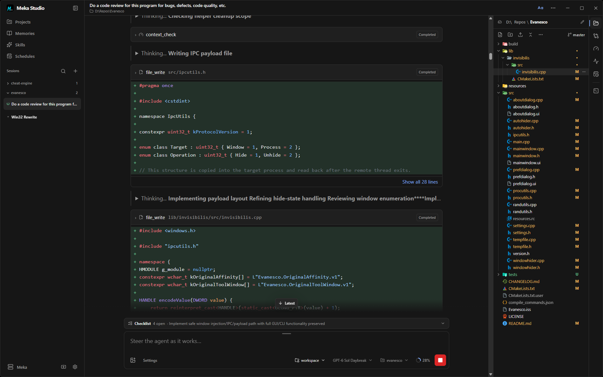

# Meka Studio

A web interface for [Meka](https://github.com/k4yt3x/meka), served from the Meka host, or a desktop app with a Meka of its own.



Meka Studio is a server you install beside Meka, on Linux, macOS or Windows. It signs you in, serves the interface, and passes your requests to Meka on loopback, so Meka itself is never exposed to your network or the internet. Put Meka Studio behind a Cloudflare Tunnel or an HTTPS proxy, and reach your Meka from any browser, or install it on your phone's Home Screen.

Besides Meka's sessions, projects, memory, skills, schedules, MCP servers, accounts and profiles, Meka Studio adds what Meka leaves to the host:

- **Sign-in**: a password or a passkey, with the devices signed in and a sign-in log.
- **Files**: the session's folder as a tree, to upload, download, move and mention files.
- **Git**: compare changes with the last commit, stage, commit, and browse the history.
- **Editor**: VS Code's Monaco, following the agent's changes on disk, and a PDF viewer.
- **Terminals**: editor tabs that keep running when you leave, for any device to return to.
- **Push notifications**: when a turn finishes, fails, or waits for you, even with the app closed.
- **Data saver**: fewer messages at once, pictures on tap, and batched replies.
- **Shared preferences**: what conversations show and how they notify, on every device.

The **desktop app**, Meka Studio Desktop for Linux, macOS and Windows, is Meka Studio for the computer you work on: it runs a Meka of its own, with its own config and sessions, in a window with a tray icon and system notifications. It needs no token, service or sign-in.

## Install

Download the desktop app from the [releases](https://github.com/k4yt3x/meka-studio/releases): an installer, the Linux AppImage, or the Windows portable zip. [Installing Meka Studio](docs/install.md) covers the app and the server. In short, with the server's `~/.config/meka-studio/config.toml` naming Meka's address and its token ([`config/meka-studio.toml`](config/meka-studio.toml) is the example):

```sh
meka-studio user add <username>
meka-studio serve
```

## Develop

Install Node.js, at the version `web/.nvmrc` names, and the Rust toolchain. Run Meka Studio against a Meka, with its `public_origin` set to the dev server's address:

```toml
listen = "127.0.0.1:4180"
public_origin = "http://localhost:5173"
state_dir = "/tmp/meka-studio-dev"

[meka]
url = "http://127.0.0.1:8080"
token_file = "/tmp/meka-studio-dev/meka-token"
```

```sh
cargo run -p meka-studio -- --config dev.toml user add me
cargo run -p meka-studio -- --config dev.toml serve
cd web
npm ci
npm run dev
```

The dev server passes `/api` and `/meka` to Meka Studio at `MEKA_STUDIO_GATEWAY`, `http://127.0.0.1:4180` unless set. `just desktop` runs the desktop app. On Linux, it and `just check` need WebKitGTK and libayatana-appindicator. See [Development](docs/development.md) for their packages, the checks and releases.

## Documentation

- [Installing Meka Studio](docs/install.md): the desktop app, the server, HTTPS, and your phone
- [Using Meka Studio](docs/usage.md): signing in, the desktop app, Files, Git, the editor, and terminals
- [API support](docs/api-coverage.md): supported Meka operations and limits
- [Architecture](docs/architecture.md): the server, the desktop app, the interface, and their invariants
- [Development](docs/development.md): layout, running it, checks, and releases
- [Changelog](CHANGELOG.md)

## License

Copyright (c) 2026 K4YT3X.

Licensed under the **GNU Affero General Public License, version 3 or later** (`AGPL-3.0-or-later`). See [LICENSE](LICENSE). Third-party components retain their respective licenses; see [third-party notices](docs/third-party.md).
